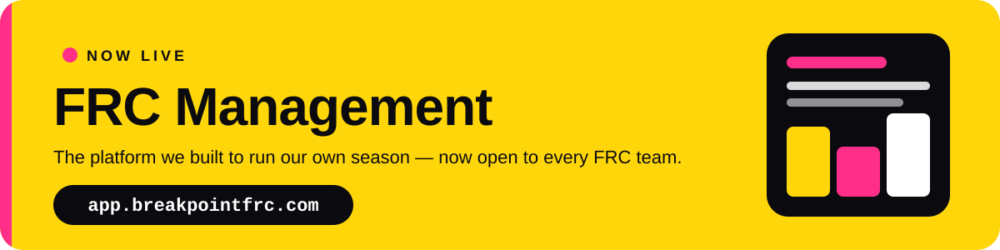

 

## 👋 Who we are

We are **BreakPoint** — a student-driven *FIRST* Robotics Competition team founded in **2026** in **Bursa, Türkiye**. Our members come from different schools and meet at **Açık Atölye Tech Hub**, where we design, build and program competition robots together.

> **Robotics is more than building a robot.** It is learning to think like engineers, working as one team, and solving real problems — and breaking a few things on the way. 💥

 

**FRC Management** puts the work behind a robot in one place: who does what, what is due, when the team meets and where the money comes from. Everyone sees exactly what their role allows — nothing more, nothing less.

<table>
  <tr>
    <td width="33%" valign="top">
      <h3>🧭 Roles &amp; departments</h3>
      President, captain, lead and member roles with permissions per department. A ready-made template sets a team up in minutes.
    </td>
    <td width="33%" valign="top">
      <h3>✅ Tasks &amp; Gantt</h3>
      Department tasks with owners and due dates, plus Gantt boards to plan the build season week by week.
    </td>
    <td width="33%" valign="top">
      <h3>📅 Meetings &amp; calendar</h3>
      Team and department meetings with attendance, all on one shared calendar.
    </td>
  </tr>
  <tr>
    <td width="33%" valign="top">
      <h3>💰 Finance &amp; sponsors</h3>
      Season income and expenses, and a sponsor pipeline that turns a closed deal into income in one step.
    </td>
    <td width="33%" valign="top">
      <h3>✉️ Join by invitation</h3>
      Members join from an email invitation and choose their own password. Invite a whole team at once from a CSV file.
    </td>
    <td width="33%" valign="top">
      <h3>🔒 Safe by design</h3>
      Secure sessions, password reset by email, an audit log of changes and encrypted mail queues.
    </td>
  </tr>
</table>

**Get started in three steps**

`1` &nbsp;[**Apply for your team**](https://app.breakpointfrc.com/apply) &nbsp;&nbsp;→&nbsp;&nbsp; `2` &nbsp;**Accept your admin invitation** &nbsp;&nbsp;→&nbsp;&nbsp; `3` &nbsp;**Invite your members** 🎉

 

## 🤖 On the field

Command-based **Java** robot software on **WPILib**, with full physics simulation and **PathPlanner** autonomous paths.

## 🤝 Sponsor a rookie team

We are building our first season and every bit of support counts. Visit **[breakpointfrc.com](https://www.breakpointfrc.com)** or write to **[info@breakpointfrc.com](mailto:info@breakpointfrc.com)**.

 

Built with 💛 🩷 🖤 at <b>Açık Atölye Tech Hub</b>, Bursa

